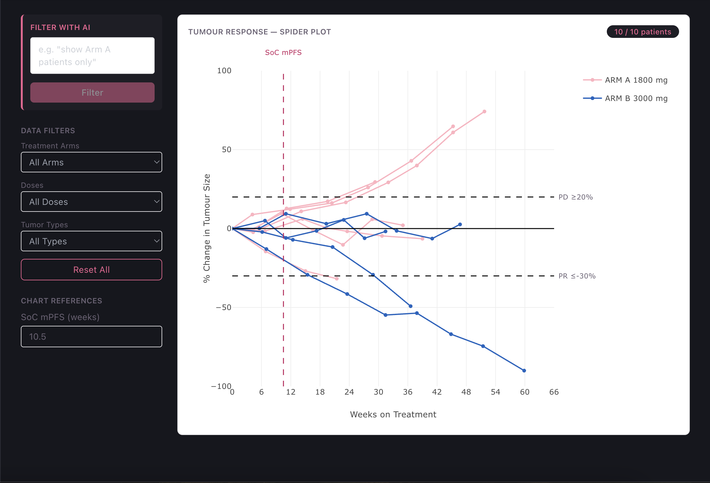

<h1 align="center">Spider Plot Dashboard</h1>

<p align="center">A clinical-trial spider plot of tumour-size change over time, with a natural-language filter that turns a typed query into arm, dose and tumour-type selections.</p>

<p align="center"></p>

<p align="center">The dashboard on the committed <code>backend/spiderplot.csv</code> (58 measurements, 10 patients), no filters applied.</p>

## Why

A spider plot of ten patients is hard to slice by arm, dose and tumour type without clicking through dropdowns. Here you can type "HNSCC patients in Arm B" and the same dropdown state is set for you. The model only extracts three values; Python code validates them and applies the filter, and queries it cannot express as arm, dose or tumour type are rejected.

---

## Quick Start

**Prerequisites**

| Tool | Version |
|------|---------|
| Python | 3.10+ |
| Node | 18+ |
| npm | 9+ |

macOS/Linux only. The `npm run dev` script calls `backend/venv/bin/flask` directly — on Windows that path does not exist.

```bash
# Clone
git clone <repo-url> && cd <repo-name>

# Python venv
cd backend && python3 -m venv venv && source venv/bin/activate
pip install -r requirements.txt && cd ..

# API key (AI filter only — rest of app works without it)
echo "ANTHROPIC_API_KEY=sk-ant-..." > backend/.env

# Frontend deps
cd frontend && npm install && cd ..

# Run
npm run dev
```

Opens at [http://localhost:5173](http://localhost:5173). Flask runs on port 5001; Vite proxies `/api/*` → Flask, stripping the prefix before it reaches Flask routes.

**Tests**

```bash
backend/venv/bin/pytest backend/tests/ -v   # pytest
cd frontend && npx vitest run               # vitest
```

---

## Architecture

CSV on disk, a Flask/Pandas API, the Vite dev proxy, a React coordinator, then a Plotly spider plot. The AI filter is a separate branch that writes the same filter state the manual dropdowns write.

- `GET /spider?arms=&doses=&tumor_types=` filters the DataFrame and returns JSON rows.
- `POST /ai-filter` builds a system prompt from the valid arm, dose and tumour values, asks Claude Haiku for a JSON object, strips code fences, validates it against those values, and returns `{arm, dose, tumor_type}`. A bad query or model output gives 400; any other failure gives 500.
- `Visualisation.jsx` owns all filter state and refetches `/spider` on change, aborting the previous request.
- `buildPatientSeries` converts days to weeks, injects a day-0 baseline and assigns a colour key; `SpiderPlot.jsx` draws the traces, the PD ≥20% and PR ≤-30% lines and the SoC mPFS line.

---

### Architecture Decisions

| # | Decision | Why |
|---|----------|-----|
| 1 | **Monorepo with Vite proxy** — Flask and React live in one repo; a single `npm run dev` starts both servers and Vite forwards `/api/*` to Flask, stripping the prefix | No CORS configuration needed in development; the frontend always uses relative paths and is never coupled to a port number |
| 2 | **LLM as structured extractor, not decision-maker** — Claude Haiku's only job is converting free-text into a 3-key JSON dict; every actual decision (validation, rejection, filter application) is made by deterministic Python code | LLM non-determinism is contained to one step; the rest of the pipeline is fully testable without API calls and produces predictable 400/500 responses |
| 3 | **Coordinator pattern for filter state** — `Visualisation.jsx` owns all filter state; the AI filter and manual dropdowns both call the same `setSelectedArm / setSelectedDose / setSelectedTumor` setters | No synchronisation logic between the two input methods; any future consumer of filter state (URL params, export, a second chart) gets it automatically |
| 4 | **`ai_filter.py` as a pure, Flask-free module** — the AI logic has no import of Flask; `parse_filter_query` takes the Anthropic client as a dependency injection parameter rather than creating it internally | The module is fully unit-testable without a running server; the LLM backend is swappable (a regex parser could replace it) without touching `app.py` |
| 5 | **Single source of truth for valid filter values** — `VALID_ARMS`, `VALID_DOSES`, `VALID_TUMORS` are derived from the live DataFrame at startup and passed into both HTTP route validation and the AI filter's system prompt | The model can only name values that actually exist in the data; adding a new arm to the CSV propagates automatically to both validation and the LLM's awareness on the next server start |

---

### Implementation Details

| # | Decision | Tradeoff |
|---|----------|----------|
| 1 | **Hermetic test fixtures** — `conftest.py` patches all four module-level constants (`df`, `VALID_ARMS`, `VALID_DOSES`, `VALID_TUMORS`) so fixture data is the only source of truth during tests | Fixture structure must stay in sync with how `app.py` derives those sets — no compile-time check enforces this |
| 2 | **O(n+m) baseline injection** — `buildPatientSeries` builds a `Set` of day-0 subjects in one pass, then does O(1) lookups to decide whether to inject a synthetic baseline, rather than scanning all rows per patient | Correctness over micro-optimisation at 58 rows; the `Set` key assumes subject IDs are consistently cased and trimmed |
| 3 | **`AbortController` with no state calls on abort** — `setLoading(false)` is moved out of `finally` so aborted fetches never update state on an unmounted component; React 18 StrictMode double-mount is handled cleanly | A `cancelled` flag and `controller.abort()` are two independent mechanisms doing the same job — intentional redundancy, minor cognitive overhead |
| 4 | **Valid sets derived from `df` at startup** — `VALID_ARMS`, `VALID_DOSES`, `VALID_TUMORS` are computed from the CSV at server start and injected into both route validation and the AI filter system prompt, so they stay in sync automatically | `FilterPanel.jsx` hardcodes the dropdown options — if the CSV gains a new arm the backend accepts it but the UI has no option for it without an `/api/meta` endpoint |
| 5 | **Cross-module contract test for `colorKey`** — a single test imports both `buildPatientSeries` and `COLOR_MAP` and asserts every produced `colorKey` has a matching entry, catching format drift (`'ARM A 1800mg'` vs `'ARM A 1800 mg'`) that would silently render lines grey | Tests both modules simultaneously — a bug in `constants.js` surfaces as a transform test failure, which can be misleading |

---

## Tech Stack

| Layer | Choice | Why |
|-------|--------|-----|
| Backend | Flask + Pandas | Lightweight REST; Pandas handles CSV type coercion and schema validation without custom parsing |
| Frontend | Vite + React | Fast HMR; React Router for two-page navigation without a full framework |
| Chart | Plotly.js (`react-plotly.js`) | Reference lines, hover templates, and legend grouping built-in; D3 would require building all of this manually |
| Styling | Tailwind CSS | Utility-first; no component library needed at this scale |
| AI | Claude Haiku via Anthropic SDK | Smallest/fastest Claude model; constrained JSON-only system prompt makes output mechanically validatable |

---

## Troubleshooting

**Flask won't start — `spiderplot.csv not found`**  
The CSV must be at `backend/spiderplot.csv`. It is committed; if it is missing, restore it with `git checkout -- backend/spiderplot.csv`.

**`npm run dev` fails with `flask: command not found`**  
The script calls `backend/venv/bin/flask`. Set up the venv first: `cd backend && python3 -m venv venv && source venv/bin/activate && pip install -r requirements.txt`.

**AI filter shows "Filtering…" for 10+ seconds then fails**  
The backend timeout is 5s × 2 retries = 10s; the frontend aborts at 12s. Under Anthropic API latency spikes, users will wait the full duration. Check `backend/.env` for a valid key first — an invalid key returns 401 immediately, not a timeout.

**AI filter returns "Could not extract a specific filter"**  
The filter only supports arm, dose, and tumour type. Queries like "show patients with more than 20% tumour growth" are explicitly unsupported — the model sets `"unsupported": true` and the backend rejects it. To reset all filters, use the Reset All button rather than asking the AI.
